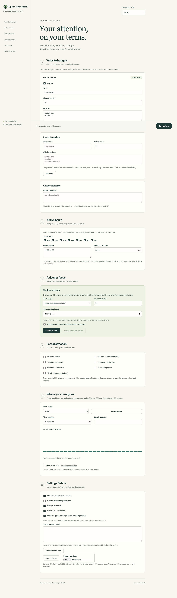

# Open Stay Focused — Open-source Website Blocker for Chrome

A local-only, open-source StayFocusd alternative for Chrome. Block distracting
websites, set daily time limits, and track browsing time on your device—without
accounts or telemetry. Free and MIT licensed.

[Download the latest release](https://github.com/xingwudao/open-stay-focused/releases/latest)
· [Install](#install)
· [简体中文](README.zh-CN.md)
· [Privacy policy](PRIVACY.md)



## Why Open Stay Focused?

- **Your browsing stats stay on your device.** No backend, account, advertising SDK
  or telemetry. Inspect the source and export your data locally.
- **Daily limits that fit your routine.** Give distracting websites a shared group
  budget, keep useful pages on an allowlist, and choose weekdays and active hours.
- **Commit to a focus session.** Start or schedule a Nuclear session. Typing
  challenges and delayed settings changes add friction when you try to relax rules.
- **See where your time goes.** Check the live focus timer, current-site usage,
  and local screen time reports for today, 7 days or 30 days. Export totals as CSV.
- **Reduce distractions inside a site.** Hide YouTube Shorts, recommendations or
  comments, plus selected Reels links, X trends and TikTok recommendations.
- **Use English or 简体中文.** Switch the interface language without clearing usage
  history or resetting your website budgets.

## Install

1. Download `open-stay-focused-0.2.4.zip` from
   [GitHub Releases](https://github.com/xingwudao/open-stay-focused/releases/latest).
2. Extract it into a folder you will keep on your computer.
3. Open `chrome://extensions`, enable **Developer mode**, choose **Load unpacked**,
   and select the extracted folder containing `manifest.json`.
4. Pin Open Stay Focused. Open **Settings**, add a website group, set its daily
   allowance and active hours, then save.

Requires Chrome 120 or newer. The extension is distributed through GitHub;
**it is not currently listed in the Chrome Web Store**. To install from source,
load the `extension/` folder.

To update, replace the files in the same folder and click **Reload** in Chrome.
Keep that folder and extension ID stable to retain local settings and usage.
Version 0.2 enables commitment protections for existing installations immediately;
read the [upgrade notes](docs/usage-guide.md#what-changes-in-02) before updating.

To switch languages, choose **English** or **简体中文** under **Language / 语言**
at the top of Settings. Language saves immediately; other settings still require
Save settings. Newly opened popup, settings and blocked pages
use the saved language. Existing installations default to English.

## Website limits, focus sessions and local reports

Add domain or page-path rules to a group, such as social media or entertainment.
Each group shares one daily allowance across its matching sites. Allowlisted pages
consume no group budget. Regular limits apply only during your active hours;
usage statistics also show browsing outside those hours.

Choose active weekdays, multiple time windows, overnight schedules and a local
reset time. For a committed focus session, the Nuclear Option can block grouped
sites, all websites except allowed ones, or all HTTP(S) websites. An active session
cannot be canceled through the extension; a future session can be canceled before
it starts.

The toolbar popup updates every second while open under normal conditions.
Closing it stops display updates; background usage accounting continues.
No floating timer is added to websites. The usage dashboard includes summary cards,
daily trends, hourly patterns, a website-share ring and ranked percentage bars.
Switch between duration and sessions, filter or search websites, and expand exact
chart values. History is retained for 30 local dates. Settings support JSON
import/export, and reports support local CSV export.

## Frequently asked questions

### Is this an open-source alternative to StayFocusd?

Yes. Open Stay Focused independently implements website time limits, focus
sessions, local usage reports and selected distraction controls under the
[MIT license](LICENSE). It is not affiliated with StayFocusd or Sensor Tower.
No vendor code, graphics or text are included. It does not support account/device
sync or importing original StayFocusd settings files.

### Does browsing data leave my device?

The extension does not send settings, usage or page content to its developers.
There is no backend or telemetry service. Persistent usage statistics contain
hostnames, not visited paths, query strings, page titles or chat content.

Current tab URLs are read to match rules and count time; checkpoint URLs live in
session storage until the browser restarts. Your configured rules can include
paths. Opening a GitHub help link and visiting ordinary websites still involves
those sites' own network behavior. See the [privacy policy](PRIVACY.md) for data
storage and permission details.

### How is website usage time counted?

By default, only the active tab in the focused browser window counts. Keeping the
toolbar popup open continues counting that website while the popup has focus. Foreground
accounting pauses after Chrome detects 60 seconds of inactivity. Optional
background-audio tracking is off by default; system lock pauses all accounting.
Concurrent tabs on the same hostname or in the same group are deduplicated for
that hostname or group. Different audible hosts can produce combined website
totals greater than elapsed wall-clock time.

Chrome can throttle or suspend callbacks. Gaps longer than 15 seconds are not
charged, and a browser restart preserves saved totals rather than the unsettled
interval. The timer is live feedback, not a hard real-time metering guarantee.
See [counting and matching rules](docs/usage-guide.md#rules-you-can-understand).

### Can I block YouTube Shorts without blocking YouTube?

You can hide YouTube Shorts elements without adding all of YouTube to a blocked
group. Separate controls hide recommendations and comments. These controls hide
selected interface elements; they do not block every route to a feed or video,
and website redesigns may require rule updates.

### Why do some settings changes take effect tomorrow?

Commitment protections make it harder to undo a limit in the moment. Purely
stricter changes skip the typing challenge; relaxing or mixed changes require it.
Exhausted positive-budget groups cannot be relaxed during active hours.
Active-hour and reset-time changes take effect at the same local time the next
calendar day; the interface shows current and pending values.

Budget increases, pausing and some other changes require additional confirmations.
These protections also apply to imports. Clearing statistics does not restore
budgets. See the [complete protection and upgrade rules](docs/usage-guide.md#what-changes-in-02).

### Can it prevent me from disabling or uninstalling it?

No. This is a self-control tool, not a firewall or parental-control system.
Disabling/uninstalling the extension or editing extension storage can bypass it.
Blocking uses a redirect after navigation, so a page may briefly appear before
being replaced. Browser-protected pages cannot be reliably monitored, and
incognito requires explicitly enabling the extension there.
See [all known limitations](docs/usage-guide.md#limits).

## Documentation

- [Usage guide and 0.2 upgrade notes](docs/usage-guide.md)
- [Privacy and permissions](PRIVACY.md)
- [Architecture](docs/architecture.md)
- [Timing, statistics and commitment research](docs/research/stayfocusd-timing-statistics-friction.md)
- [Initial research and independent implementation](docs/research/stayfocusd-4.6.17.md)
- [Verification record](docs/verification.md)

## Develop and verify

Requires Node.js 22 or newer. Runtime code has no npm dependencies.

```sh
npm ci
npx playwright install chromium
npm test
npm run test:browser
npm run build
npm run package
```

On Linux CI, install browser system dependencies with
`npx playwright install --with-deps chromium`.
Tests launch isolated Playwright Chromium profiles, never your personal Chrome
profile. Unit tests exercise injected clocks/storage; integration tests load
real extension pages and content scripts. Build checks manifest references and
JavaScript syntax. Packaging emits a deterministic ZIP and `dist/SHA256SUMS`.

## Contribute

Bug reports should include browser version, minimal rules and expected/actual
behavior. Do not upload browsing history or personal settings. See
[CONTRIBUTING.md](CONTRIBUTING.md). Source and original artwork are MIT licensed.
