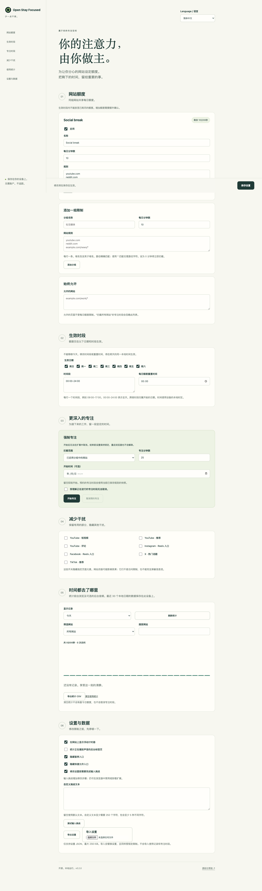

# Open Stay Focused — 开源 Chrome 网站屏蔽与专注插件

一个数据保存在本地的开源 StayFocusd 替代品。屏蔽分心网站、设置每日网站限时，
在设备上查看浏览时长统计。无需账户、无遥测，免费使用，采用 MIT 许可证。

[下载最新版本](https://github.com/xingwudao/open-stay-focused/releases/latest)
· [安装方法](#安装方法)
· [English](README.md)
· [隐私政策（英文）](PRIVACY.md)



## 为什么选择 Open Stay Focused？

- **浏览统计留在设备上。** 无后端、无账户、无广告 SDK、无遥测。
  源码可以审查，数据可以在本地导出。
- **按自己的作息设置限额。** 为一组分心网站共享每日额度，
  将需要的页面加入白名单，并选择生效星期和时段。
- **为专注增加约束。** 立即开始或预约强制专注；
  输入挑战和延迟生效规则，为临时放宽限制增加阻力。
- **看清时间花在哪里。** 实时计时器显示当前网站用时，
  本地报告提供今天、近 7 天和近 30 天统计，并支持 CSV 导出。
- **减少网站内部的干扰。** 隐藏 YouTube Shorts、推荐或评论，
  以及部分 Reels 入口、X 趋势和 TikTok 推荐元素。
- **支持中文和英文。** 切换界面语言不会清空使用记录或重置网站额度。

## 安装方法

1. 从 [GitHub Releases](https://github.com/xingwudao/open-stay-focused/releases/latest)
   下载 `open-stay-focused-0.3.1.zip`。
2. 解压到准备长期保留的文件夹。
3. 打开 `chrome://extensions`，启用“开发者模式”，选择“加载已解压的扩展程序”，
   选中包含 `manifest.json` 的解压文件夹。
4. 固定扩展图标，打开设置，添加网站分组，设置每日额度和生效时段，然后保存。

需要 Chrome 120 或更高版本。目前通过 GitHub 分发，**尚未上架 Chrome 应用商店**。
从源码安装时，加载仓库中的 `extension/` 文件夹。

更新时，在原文件夹中替换文件，再在 Chrome 中点击“重新加载”。
保持文件夹和扩展 ID 不变，以保留本地设置与使用记录。
0.2 版本会为已有安装立即启用防反悔限制；更新前请阅读
[升级说明（英文）](docs/usage-guide.md#what-changes-in-02)。

切换语言：在设置顶部的 **Language / 语言** 中选择 **简体中文** 或 **English**，
语言会立即保存；其他设置仍需点击保存。新打开的弹窗、设置页和拦截页会使用已保存的语言。
已有安装默认使用英文。语言切换不会解除专注锁定或输入挑战。

## 网站限时、强制专注与本地统计

新安装默认每天本地时间 03:00 恢复网站额度，跨午夜不会恢复；
到了 03:00 即会恢复，即使还没睡。这是固定时间重置，不检测睡眠。
经常熬夜可在「生效时段」中设置更晚的重置时间。
升级保留已有设置（包括 00:00），修改在次日同一时刻生效。
统计仍按自然日展示，历史记录不会被清空。

为社交媒体、娱乐网站等分组添加域名或页面路径规则。
同组网站共享每日额度，白名单页面不消耗分组额度。
常规限额仅在生效时段内计算；使用统计也会记录时段外的浏览时间。

支持生效星期、多个时间区间、跨午夜时段和本地重置时间。
强制专注（Nuclear Option）可以立即开始或预约，范围包括分组网站、
白名单以外的网站或全部 HTTP(S) 网站。
已开始的专注不能通过扩展界面取消；尚未开始的预约可以取消。

工具栏弹窗展开时，在正常条件下每秒更新倒计时；关闭后停止界面刷新，后台仍累计用时。
网页上不再显示浮动计时器。
报告提供总时长、会话次数、网站数量和最活跃时段概览，
支持每日趋势、小时分布、网站占比环形图，以及带占比条的网站排行。
时长和会话指标可切换，并支持筛选、搜索与图表数值明细；
保留最近 30 个本地日期的历史。设置支持 JSON 导入导出，统计支持本地 CSV 导出。

## 常见问题

### 这是开源的 StayFocusd 替代品吗？

是。Open Stay Focused 独立实现网站限时、专注会话、本地使用报告和部分干扰隐藏功能，
采用 [MIT 许可证](LICENSE)，与 StayFocusd 或 Sensor Tower 没有关联。
不包含原版代码、图片或文案。不支持账户或跨设备同步，也不能导入原版 StayFocusd 设置文件。

### 浏览数据会离开我的设备吗？

扩展不会将设置、使用记录或页面内容发送给开发者，没有后端或遥测服务。
持久化使用统计保存域名，不保存访问路径、查询参数、页面标题或聊天内容。

运行时会读取当前标签页 URL，用于匹配规则和计时；计时检查点 URL 仅存放于
浏览器会话存储中，不会跨浏览器重启保留。你配置的网站规则可以包含路径。
打开 GitHub 帮助链接或访问普通网站，仍会发生这些网站自身的网络通信。
详细数据存储与权限说明见[隐私政策（英文）](PRIVACY.md)。

### 网站浏览时长是怎样计算的？

默认只计算获得焦点的浏览器窗口中的活动标签页。
工具栏弹窗打开并获得焦点时，仍会继续计算下方活动网站的时间。
Chrome 检测到连续 60 秒无操作后，前台计时暂停。
后台音频计时默认关闭，可手动启用；系统锁定时暂停全部计时。
同一域名或同一分组中的并发标签页，会在对应域名或分组的计时中去重。
不同域名同时播放音频时，网站时长总和可能超过实际经过的时间。

Chrome 可能限制或暂停回调。超过 15 秒的间隔不计费；浏览器重启保留已保存的总量，
不补计尚未结算的间隔。实时显示用于提供反馈，不保证严格实时计量。
完整说明见[计时与匹配规则（英文）](docs/usage-guide.md#rules-you-can-understand)。

### 能隐藏 YouTube Shorts，同时保留 YouTube 吗？

可以启用 Shorts 隐藏功能，而不将整个 YouTube 加入屏蔽分组。
推荐和评论也有独立控制。这些功能隐藏指定界面元素，不会封堵所有信息流或视频访问路径；
网站改版后可能需要更新规则。

### 为什么有些设置修改要到明天才生效？

防反悔限制用来增加临时撤销额度的难度。
纯粹收紧规则无需输入挑战；放宽或混合修改需要完成挑战。
正额度分组耗尽后，在生效时段内不能放宽限制。
生效时段与重置时间的修改，要到下一个本地日历日的同一时间生效；
界面会展示当前值和待生效值。

增加额度、暂停及部分其他修改需要额外确认，这些保护也适用于导入设置。
清空统计不会恢复额度。完整规则见[保护机制与升级说明（英文）](docs/usage-guide.md#what-changes-in-02)。

### 能阻止我禁用或卸载扩展吗？

不能。它是自我约束工具，不是防火墙或家长控制系统。
禁用、卸载或修改扩展存储可以绕过限制。
屏蔽通过导航后的重定向实现，页面可能短暂显示后才被替换。
浏览器保护页面无法可靠监测；无痕模式需要另外允许扩展运行。
详见[已知限制（英文）](docs/usage-guide.md#limits)。

## 文档

以下技术文档目前为英文：

- [使用指南与 0.2 升级说明](docs/usage-guide.md)
- [隐私与权限](PRIVACY.md)
- [架构说明](docs/architecture.md)
- [计时、统计与防反悔机制研究](docs/research/stayfocusd-timing-statistics-friction.md)
- [初步研究与独立实现](docs/research/stayfocusd-4.6.17.md)
- [验证记录](docs/verification.md)

## 开发与验证

需要 Node.js 22 或更高版本。扩展运行时代码没有 npm 依赖。

```sh
npm ci
npx playwright install chromium
npm test
npm run test:browser
npm run build
npm run package
```

Linux CI 可使用 `npx playwright install --with-deps chromium` 安装浏览器系统依赖。
测试使用隔离的 Playwright Chromium 配置，不使用个人 Chrome 配置。
单元测试使用注入的时钟和存储，集成测试加载真实扩展页面与内容脚本。
构建检查清单引用和 JavaScript 语法；打包生成确定性 ZIP 与 `dist/SHA256SUMS`。

## 参与贡献

报告问题时，请提供浏览器版本、最小规则配置，以及预期与实际行为。
不要上传浏览历史或个人设置。详见 [CONTRIBUTING.md](CONTRIBUTING.md)。
源码和原创美术资源采用 MIT 许可证。

## 本地文件阅读时间（v0.3.1）

Chrome 中的本地 PDF 等 `file://` 标签页可自动统计前台阅读用时，
无需点击扩展图标。切换到其他标签或应用、最小化浏览器、电脑空闲或锁屏时暂停。
所有本地文件合并显示为“本地文件”，可在统计页筛选并导出 CSV。
不读取文件内容，不保存文件名或路径，不新增文件访问权限；
本地文件不消耗网站额度，也不受网站强制专注拦截。
